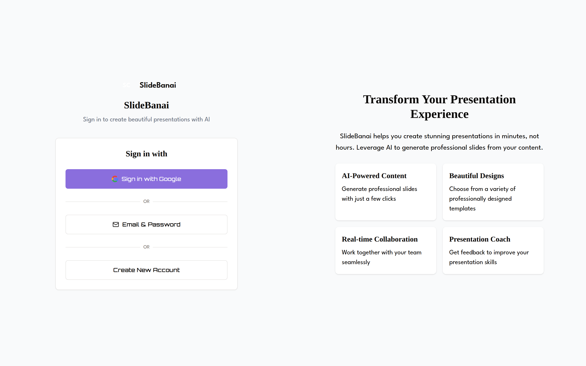
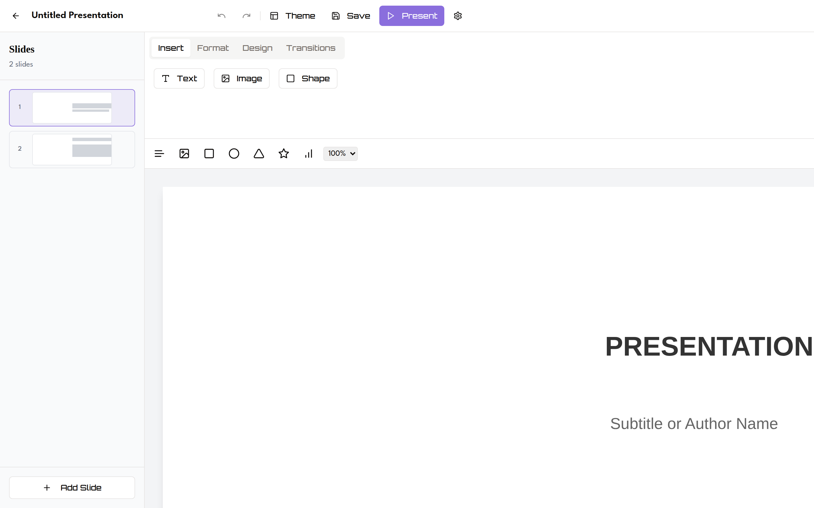
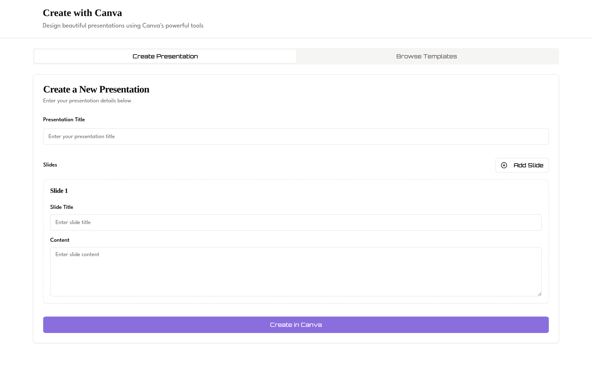
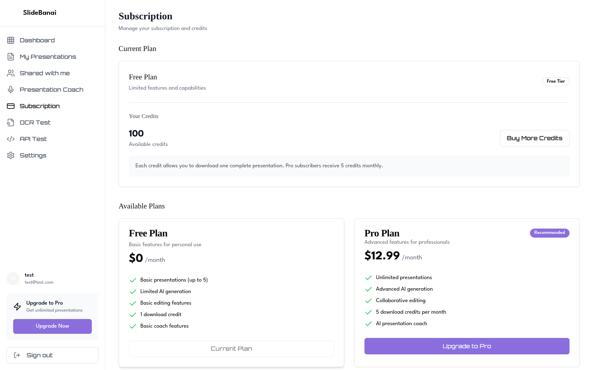
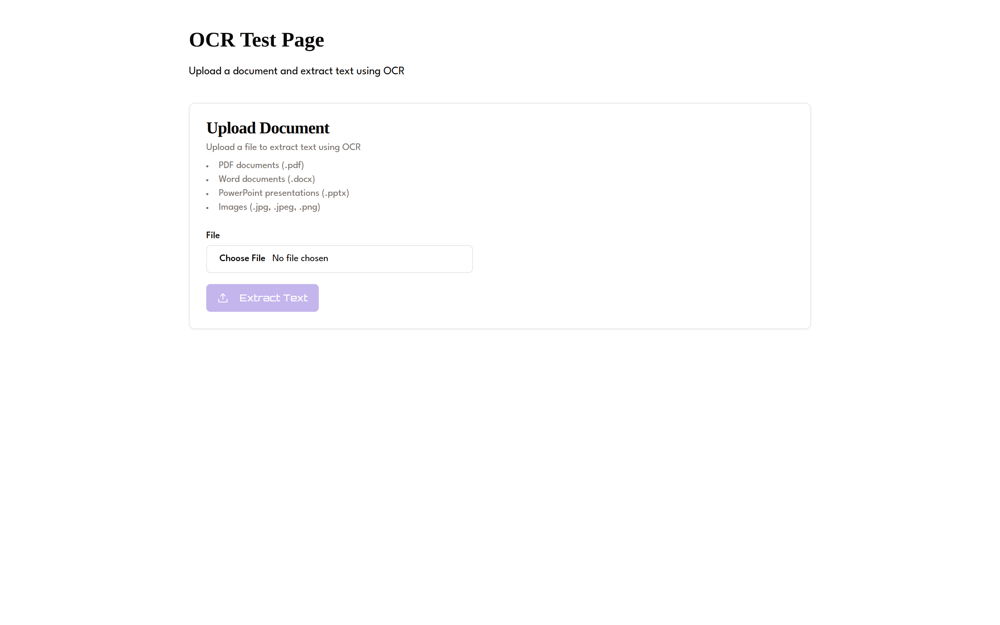
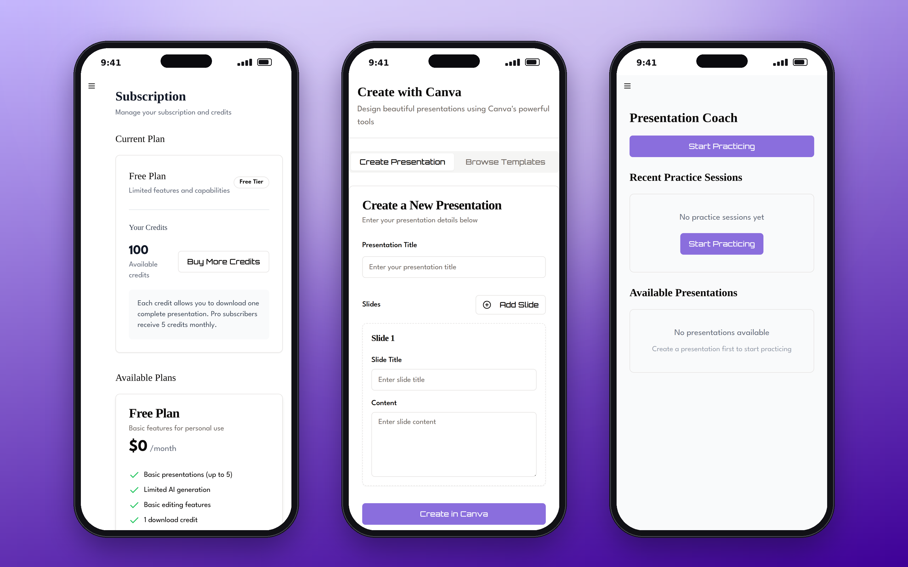
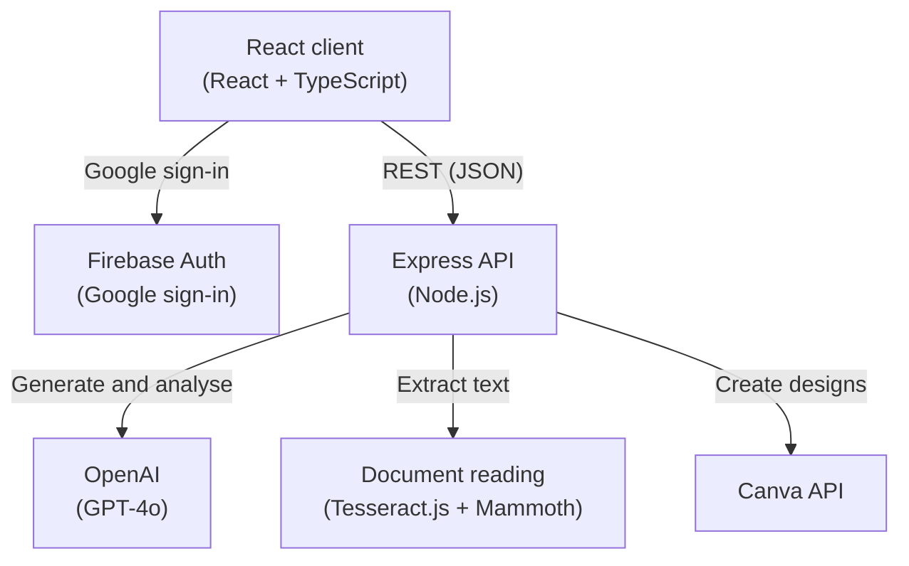

<div align="center">

# SlideBanai

**An AI-powered presentation builder and coach.**

Draft slides with AI, edit and design them, turn existing notes into slides with OCR, and practise your delivery with an AI coach, all in one app.

[](https://slidebanai-d4210.web.app)




</div>

---

## Table of Contents

- [About](#about)
- [Features](#features)
- [Screenshots](#screenshots)
- [Tech Stack](#tech-stack)
- [Architecture](#architecture)
- [Repository Structure](#repository-structure)
- [Getting Started](#getting-started)
- [Environment Variables](#environment-variables)
- [API Overview](#api-overview)
- [Team](#team)
- [Acknowledgements](#acknowledgements)

## About

Making a good presentation takes hours. You write the content, design the slides, and then practise the delivery, usually with a different tool for each step.

**SlideBanai** puts those steps in one app:

1. **Write.** Describe a topic and AI drafts the slides, or upload existing notes and let OCR and AI turn them into slides.
2. **Design.** Edit the slides in the built-in editor, or send them to Canva to design them there.
3. **Practise.** Rehearse with the Presentation Coach and get AI feedback and scores on your delivery.

SlideBanai won **Champion** at the **UIU CSE Project Show, Spring 2025**.

## Features

| Feature | Description |
| --- | --- |
| **AI slide generation** | Enter a topic and get a draft presentation generated with OpenAI GPT-4o. |
| **Slide editor** | Add text, images, and shapes, then apply themes and transitions. Present mode is built in. |
| **Notes to slides (OCR)** | Upload a PDF, Word (`.docx`), PowerPoint (`.pptx`), or image file. The text is extracted with OCR and summarised into slides. |
| **Canva integration** | Create a presentation in Canva from slide titles and content, or browse Canva templates. |
| **Presentation Coach** | Practise a talk and get AI feedback and scores on content coverage, pace, clarity, and eye contact. |
| **Collaboration** | Share presentations with collaborators and see them under *Shared with me*. |
| **Credits and subscriptions** | Free plan with credits, plus a Pro plan with more downloads and AI features. |
| **Export** | Download generated slides as a PowerPoint (`.pptx`) file. |
| **Authentication** | Google sign-in with Firebase Auth, plus email and password accounts. |

## Screenshots

| Slide editor | Create with Canva |
| :---: | :---: |
|  |  |
| **Subscription and credits** | **Notes to slides (OCR)** |
|  |  |

<p align="center">
  
  <br />
  <em>On mobile: subscription and credits, creating a presentation in Canva, and the Presentation Coach.</em>
</p>

## Tech Stack

| Layer | Technologies |
| --- | --- |
| **Frontend** | React, TypeScript, Vite, Tailwind CSS, shadcn/ui (Radix UI), TanStack Query, React Hook Form, Zod, Framer Motion, Wouter |
| **Backend** | Node.js, Express, Passport (session-based auth), express-session |
| **AI and documents** | OpenAI GPT-4o, Tesseract.js (OCR), Mammoth (Word), pdf-parse, officegen (PowerPoint export) |
| **Auth and hosting** | Firebase Authentication (Google sign-in), Firebase Hosting |
| **Integrations** | Canva API |

## Architecture

SlideBanai is a React single-page app backed by an Express API. The client signs users in with Firebase and calls the API, which talks to OpenAI, reads uploaded documents, and connects to Canva.



- **React client:** dashboard, presentations list, slide editor, Presentation Coach, OCR upload, Canva, and subscription pages. Routes are protected, so signed-out users are sent to the sign-in page.
- **Express API:** accounts, presentations, slides, collaborators, coach sessions, and credits. It also hosts the AI, OCR, and Canva endpoints and exports slides as `.pptx`.
- **OpenAI (GPT-4o):** generates draft slides, scores practice sessions, and summarises text extracted by OCR.
- **Document reading:** pulls text out of PDFs, Word and PowerPoint files, and images so it can become slides.
- **Canva:** creates presentations from slide titles and content, and lists templates.

## Repository Structure

```text
SlideBanai/
├── slide-banai-client/            # React + TypeScript web app
│   ├── App.tsx                    # Routes (Wouter) and providers
│   ├── main.tsx                   # Entry point
│   ├── pages/                     # Dashboard, editor, coach, OCR, Canva, subscription, auth
│   ├── components/                # App components
│   │   ├── editor/                # Slide canvas, slide list, editor toolbar
│   │   ├── canva/                 # Canva integration and template list
│   │   ├── auth/                  # Google sign-in button
│   │   └── ui/                    # shadcn/ui components
│   ├── hooks/                     # use-auth, use-toast, use-mobile
│   ├── lib/                       # Firebase setup, query client, protected route
│   ├── services/                  # Auth and Canva API clients
│   └── SlideBanaiLandingPage/     # Standalone marketing landing page (Vite + React)
├── slide-banai-server/            # Express API
│   ├── index.ts                   # Server entry point
│   ├── auth.ts                    # Passport sessions, register/login, Google auth
│   ├── openai.ts                  # GPT-4o prompts (slides, coach, summaries)
│   ├── ocr.ts                     # Document text extraction and .pptx export
│   ├── canva.ts                   # Canva API integration
│   ├── storage.ts                 # Storage layer (in-memory)
│   ├── routes/ Controller/ services/ middlewares/ models/
│   └── types/                     # Type declarations for officegen and pdf-parse
├── slide-banai-ai-ml/             # AI/ML workstream
├── slide-banai-design/            # Design workstream
└── docs/screenshots/              # Images used in this README
```

## Getting Started

### Try it online

The quickest way to see SlideBanai is the live app:

**[slidebanai-d4210.web.app](https://slidebanai-d4210.web.app)**

1. Sign in with Google, or create an account.
2. Click **+ New Presentation** and generate slides from a topic, start from a template, or upload your notes.
3. Edit the slides in the editor or open them in Canva.
4. Open **Presentation Coach** to practise and get feedback.

### Run the landing page locally

The marketing landing page is a self-contained Vite project:

```bash
git clone https://github.com/mahfuzhasanreza/SlideBanai.git
cd SlideBanai/slide-banai-client/SlideBanaiLandingPage
npm install
npm run dev
```

Then open the URL that Vite prints (usually `http://localhost:5173`).

### Run the full app locally

> [!NOTE]
> This repository holds the source code of the client and the server. The shared database schema (`@shared/schema`) and the root project configuration (`package.json`, `vite.config.ts`, `tsconfig.json`) are not included yet, so the full app does not run straight from a fresh clone.

With those files in place, the server serves both the API and the client on **port 5000**:

- In development, it runs Vite as middleware for hot reloading.
- In production, it serves the built client as static files.

Data is kept in memory (`MemStorage`), so it resets when the server restarts.

**Prerequisites:** Node.js 18 or later, npm, an OpenAI API key, a Firebase project with Google sign-in enabled, and (optionally) Canva API credentials.

## Environment Variables

Create a `.env` file and set these values. Never commit real keys.

```env
# Server
OPENAI_API_KEY=your_openai_api_key
SESSION_SECRET=a_long_random_string
CANVA_API_KEY=your_canva_api_key
CANVA_APP_ID=your_canva_app_id

# Client (Vite exposes only VITE_-prefixed variables)
VITE_FIREBASE_API_KEY=your_firebase_api_key
VITE_FIREBASE_PROJECT_ID=your_firebase_project_id
VITE_FIREBASE_APP_ID=your_firebase_app_id
```

| Variable | Used by | Purpose |
| --- | --- | --- |
| `OPENAI_API_KEY` | Server | Slide generation, coach feedback, and summaries |
| `SESSION_SECRET` | Server | Signs session cookies |
| `CANVA_API_KEY`, `CANVA_APP_ID` | Server | Canva integration |
| `VITE_FIREBASE_API_KEY`, `VITE_FIREBASE_PROJECT_ID`, `VITE_FIREBASE_APP_ID` | Client | Firebase Auth (Google sign-in) |

## API Overview

All endpoints are served under `/api`. Most require a signed-in session.

| Area | Method | Endpoint | Description |
| --- | --- | --- | --- |
| **Auth** | `POST` | `/api/register` | Create an account |
| | `POST` | `/api/login` | Sign in with email and password |
| | `POST` | `/api/auth/google` | Sign in with a Firebase Google token |
| | `POST` | `/api/logout` | Sign out |
| | `GET` | `/api/user` | Get the current user |
| **Presentations** | `POST` | `/api/presentations` | Create a presentation |
| | `GET` | `/api/presentations` | List your presentations |
| | `GET` | `/api/presentations/shared` | List presentations shared with you |
| | `GET` / `PUT` / `DELETE` | `/api/presentations/:id` | Read, update, or delete a presentation |
| **Slides** | `POST` | `/api/slides` | Add a slide |
| | `GET` | `/api/presentations/:id/slides` | List a presentation's slides |
| | `PUT` | `/api/slides/:id` | Update a slide |
| **AI** | `POST` | `/api/ai/generate-slides` | Generate slides from a topic |
| | `POST` | `/api/ai/summarize` | Summarise text |
| **OCR** | `POST` | `/api/ocr/extract` | Extract text from an uploaded file |
| | `POST` | `/api/ocr/summarize` | Summarise extracted text into slides |
| **Canva** | `GET` | `/api/canva/templates` | List Canva templates |
| | `POST` | `/api/canva/presentations` | Create a presentation in Canva |
| | `GET` | `/api/canva/designs/:designId` | Get a Canva design |
| **Templates** | `GET` | `/api/templates` | List built-in slide templates |

## Team

SlideBanai was built by **Team CurlZero**, a team of five:

| Member | Role |
| --- | --- |
| [**Mahfuz Hasan Reza**](https://github.com/mahfuzhasanreza) | Frontend: set up the React + TypeScript client and built its pages (landing, sign-in, dashboard, presentations, slide editor, coach, OCR upload, Canva, subscription) |
| **Robiul Awoul Robin** | Team member |
| **Zobaer Ibn Razzaque** | Team member |
| **Sadman Adib** | Team member |
| **Maisha Maliha Neha** | Team member |

## Acknowledgements

- Built for the CSE Project Show at **United International University (UIU)**, Spring 2025, where it won **Champion**.
- [OpenAI](https://openai.com), [Canva](https://www.canva.dev), [Firebase](https://firebase.google.com), [Tesseract.js](https://tesseract.projectnaptha.com), and [shadcn/ui](https://ui.shadcn.com).

---

<div align="center">
  <sub>Made with Team CurlZero.</sub>
</div>
